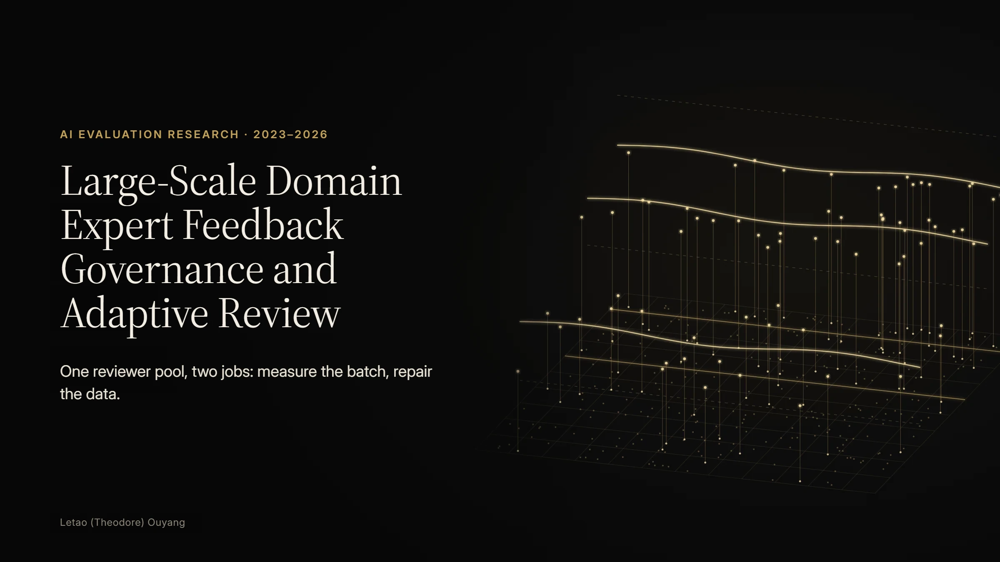
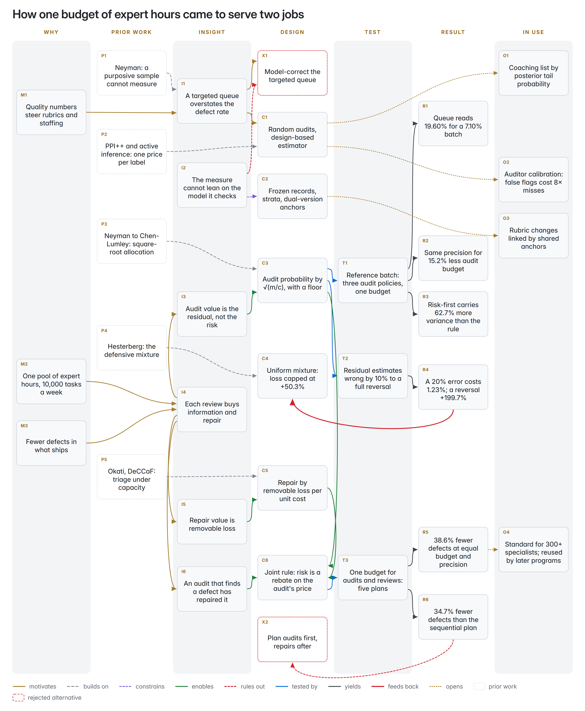

<p align="center"></p>

# Large-Scale Domain Expert Feedback Governance and Adaptive Review

**Letao (Theodore) Ouyang** · Researcher · Duke University × Leading Foundation Model Developer · September 2023 – September 2026

[Article](manuscript/large-scale-domain-expert-feedback-governance-and-adaptive-review.md) · [PDF](paper/paper.pdf) · [Results](reproduce/results.md) · [Derivations](docs/derivations.md) · [Design notes](docs/design-notes.md) · [Research route](docs/research-route.md) · [Literature](docs/literature.md)

**How should a post-training program spend a limited pool of expert reviewers when every review does two jobs at once?**

A review tells the team something about the quality of the whole batch, and it repairs the data that ships.
Programs usually send review to the riskiest submissions. That makes the dashboard overstate the batch's defect
rate, and it spends repair capacity where a review fixes least. I derived the allocation each job calls for and one
rule that prices them against each other. At the same budget and the same measurement precision, that rule ships
**38.6% fewer defects** than risk-first routing on a reference batch at the program's scale, and 19% to 67% fewer
across a 20% envelope around it. The design coordinated more than 300 specialists on weekly batches of over 10,000
tasks, and later post-training programs reused it.

## Three results to start with

| Result | Why it matters | Where |
| --- | --- | --- |
| A risk-first review queue reads **19.60%** on a batch whose defect rate is 7.10%, an overstatement of 1.96 to 4.14 times across the envelope | The dashboard most programs watch measures how well review is targeted. Better targeting makes it read worse | [§1, §6](manuscript/large-scale-domain-expert-feedback-governance-and-adaptive-review.md) · [D1](docs/derivations.md#d1-what-a-review-queue-estimates) |
| The same measurement precision for **15.2%** less audit budget, at every precision target ($`\kappa = 0.848`$; 7.5% to 27.3% across the envelope) | The saving is a property of the batch and not of the target, and the hours it frees go to repair | [§4](manuscript/large-scale-domain-expert-feedback-governance-and-adaptive-review.md) · [D8](docs/derivations.md#d8-the-gain-over-uniform-sampling-and-the-budget-identity) |
| **38.6%** fewer defects shipped at the same budget and the same precision (19% to 67%) | Risk-first routing turns out to be the joint rule of a program that puts no value on knowing its batch quality | [§5, §6](manuscript/large-scale-domain-expert-feedback-governance-and-adaptive-review.md) · [D13](docs/derivations.md#d13-the-joint-rule) |

All 158 figures in the article are recomputed in [results](reproduce/results.md).

## The problem

Each week the program received a batch of more than 10,000 expert-written tasks, and a pool of more than 300
specialists, with external vendor queues, could review only part of it. Two needs competed for the same hours:

1. **A quality number someone can act on.** Is this batch better than last week's? Is a contributor improving? Did
   a rubric change move the defect rate?
2. **Fewer defects in what ships.** Which submissions get another expert pass before delivery?

A review routed to a likely error is good repair and a biased measurement. With audit probability $`\pi(X)`$ and
true error probability $`q(X)`$, the error rate in the reviewed queue is

```math
E[Y \mid S = 1] = E[Y] + \frac{\mathrm{Cov}(\pi(X), q(X))}{E[\pi(X)]},
```

so the queue reads higher the better review is targeted. Contributor accuracy is distorted the same way, because
measured accuracy follows the task mix a contributor is assigned.

## The idea

Give each task three numbers in place of one risk score. They rank tasks differently, and each drives a different
decision.

| Quantity | Question it answers | What it drives |
| --- | --- | --- |
| Initial error risk $`q_i`$ | How likely is the submission to be wrong? | Monitoring and priors |
| Audit information value $`m_i/c_i`$, with $`m_i = q_i(1-q_i) + (q_i-f_i)^2`$ | How much does an audit sharpen the batch estimate, per unit of expert cost? | Audit probabilities |
| Removable loss $`\Delta_i = r_{i0} - r_{i1}`$ | How much expected loss does one more expert pass remove? | Repair |

A task that is almost certainly wrong and already predicted wrong has high $`q_i`$ and $`m_i \approx 0`$: auditing
it teaches the estimate nothing. A high-risk task that is missing external evidence has a small $`\Delta_i`$:
another reviewer cannot supply what it lacks.

**Measurement.** Independent reference audits are drawn with known probabilities and read through a
prediction-assisted inverse-probability estimator. The estimate is unbiased for any predictions at all, because the
only randomness it relies on is the audit lottery the program itself runs. Audit probabilities follow
$`\pi_i \propto \sqrt{m_i/c_i}`$ with a floor, and a mixture with the uniform design caps the loss at +50.3% for
any residual estimates whatever.

**One rule for both jobs.** A reference audit produces a reference solution, so an audited defect ships corrected.
Putting that into the batch program gives

```math
\pi_i^* = \mathrm{clip}_{[\pi_{\min},1]}\left(\sqrt{\frac{\nu\, m_i}{(\lambda c_i - r_i)_+}}\right),
```

where $`\lambda`$ prices the budget, $`\nu`$ prices precision and $`r_i`$ is the item's residual risk. Three
readings carry the argument:

- **Risk is a rebate.** Risk does not drive the audit. It makes the audit cheaper, by the repair the audit performs
  on the way.
- **Measurement alone.** If audits repaired nothing the rebate would vanish and the rule would be the
  $`\sqrt{m_i/c_i}`$ allocation.
- **Repair alone.** With $`\nu = 0`$ the rule audits exactly the items with $`r_i \ge \lambda c_i`$, a threshold on
  risk per unit cost. That is risk-first routing.

The batch program separates by price, so a week of ten thousand tasks is a search over a handful of multipliers.

## Results on the reference batch

Production records are withheld under the nondisclosure agreement. Results are stated on a reference batch at the
program's scale: 10,000 submissions in three strata by difficulty, with defect rates and audit costs that rise with
difficulty. Each headline result is given at the reference batch and as its range over an envelope in which each
entry of the batch moves independently by up to 20%.

**Measurement at equal audit budget**

| Audit policy | Audit probability by stratum | SD of the estimate (pp) | Variance vs uniform | Over the envelope |
| --- | --- | ---: | ---: | --- |
| Uniform sampling | 14.81% / 14.81% / 14.81% | 0.568 | baseline | baseline |
| Risk-first | 3.00% / 11.56% / 43.33% | 0.657 | +33.8% | −16% to +97% |
| **Residual- and cost-aware** | 7.89% / 19.37% / 21.84% | **0.515** | **−17.8%** | −9% to −32% |

The residual- and cost-aware rule measures better than uniform sampling everywhere in the envelope, and risk-first
routing measures worse than the rule everywhere in it, by 62.7% at the reference batch and 14% to 137% across the
envelope. Whether risk-first routing beats random sampling depends on how predicted risk happens to line up with
residual uncertainty and audit cost, which nothing in that policy controls.

**One budget for audits and reviews**

| Plan | Audit probability by stratum | Share of each stratum reviewed | SD (pp) | Defects shipped |
| --- | --- | --- | ---: | ---: |
| Risk-first for audits and for reviews | 3.00% / 11.56% / 43.33% | 0% / 67% / 100% | 0.657 | 320.9 |
| Measurement rule, then reviews by removable loss | 7.89% / 19.37% / 21.84% | 0% / 100% / 50% | 0.515 | 336.2 |
| **Joint rule at the precision of risk-first routing** | 3.31% / 9.57% / 100% | 0% / 61% / 0% | 0.657 | **197.1** |
| **Joint rule at the precision of uniform sampling** | 4.20% / 12.74% / 100% | 0% / 52% / 0% | 0.568 | **209.9** |
| Joint rule with no precision ceiling | 3.00% / 3.00% / 100% | 0% / 75% / 0% | 1.035 | 174.9 |

The second row shows why the two jobs cannot be planned one after the other: it gives the best estimate in the
table and ships more defects than the policy it replaces. Held to that plan's own precision of 0.515 points, the
joint rule ships 34.7% fewer defects, and 12.4% to 69.3% fewer across the whole envelope. The last three rows are an exchange rate. Holding the
estimate at 0.657 points costs 22 shipped defects, and tightening it to 0.568 costs 13 more. A program that knows
this number can decide how much it wants to know.

**How accurate the inputs must be.** Errors in the residual estimates cost a quarter of their weighted variance:
a 20% relative error raises the variance by 1.23%, and a common over- or underestimate costs nothing.

**What an auditor's error costs.** A 2% false-flag rate raises the audit budget by 43.8% at the same precision; a
5% miss rate raises it by 5.2%. Auditor calibration starts with the false flag.

## What is new

The estimator, the square-root allocation and the defensive mixture come from survey sampling and importance
sampling. What I built from them:

1. **One budget of expert hours priced for two jobs, in one rule.** The joint rule sets audit probabilities and
   review actions together, with the audit's repair inside its own price. Prediction-powered and active inference
   price measurement; learning to defer prices assignment. The closest work on cost, cost-optimal active
   evaluation (2025), prices two rater types and repairs nothing.
2. **Risk-first routing located inside the rule.** The legacy policy is the corner $`\nu = 0`$. The result explains
   why risk-first routing works as repair and why it fails as measurement, in one formula.
3. **The budget identity.** Every precision target costs the same fraction $`\kappa = S^2/(CM)`$ of the uniform
   audit budget, so the value of the allocation is one number per batch.
4. **The quarter-variance law.** The cost of wrong residual estimates is $`\tfrac14\mathrm{Var}_w(\varepsilon)`$
   to second order, which sets the accuracy the estimation pipeline has to reach, with a finite-batch ceiling for
   the case it does not.
5. **A cost for every item.** Neyman allocation on the residual, as in Chen and Lumley (2020), with a separate
   expert cost per item, a sampling floor and exact finite-batch variances.
6. **The price of an auditor's error, in audit hours.** The classical correction for an imperfect label combined
   with the budget identity.

[Where this work sits](docs/literature.md) sets each of these against the closest prior work, and the
[bibliography](docs/bibliography.md) lists all 154 sources.

## How the argument was built

<picture>
  <source media="(prefers-color-scheme: dark)" srcset="assets/route-dark.png">
  
</picture>

The route is a network. Measurement and repair draw on the same hours, so they were worked out against each other,
and two results went back and changed the design.

- **A measurement that does not lean on the risk model.** Correcting the targeted queue with a model would make the
  estimate depend on the model it is meant to check, so the design runs a separate stream of random audits.
- **What an audit is worth.** Valuing a review as information leads to the residual and away from the risk.
- **Surviving wrong inputs.** A reversed residual ordering raised the variance to 199.7% above uniform. That result
  went back into the design as the uniform mixture, which caps the loss at +50.3%.
- **One rule for both.** Planning audits first and repairs after shipped more defects than risk-first routing, and
  at that plan's own precision the joint rule ships 12.4% to 69.3% fewer across the envelope. That result ruled out
  sequential planning and left the joint rule.

The [research route](docs/research-route.md) explains all 35 steps and all 35 links.

## In production

- The framework supported more than 300 domain specialists across several specialties and an external vendor
  network, on roughly one batch a week of more than 10,000 tasks.
- Tiered review ran on Beta-Binomial reliability posteriors: a flagged submission went to three additional
  specialists, an initially accepted one to one or two.
- SQL and Python pipelines supplied the solvers with unit verification costs, task-stratum latencies and specialist
  capacity limits from platform and KPI records.
- Contributor reliability records, tiered review workflows and random reference audits became the program's
  operating standards, and later post-training programs took over the design.

## If you run a review program

| If you | The article shows | Do this |
| --- | --- | --- |
| Report the error rate of your review queue as batch quality | The queue rate is the batch rate plus a covariance term that grows with targeting | Keep a random audit stream with logged probabilities and report the corrected rate with its interval |
| Send audits to the riskiest items | Audit value is the residual per unit cost, not the risk | Allocate by $`\sqrt{m_i/c_i}`$, mixed with the uniform design |
| Rank repairs by initial risk | Repair value is removable loss | Estimate post-review risk with randomized pilots and rank by removable loss per unit cost |
| Plan audits and reviews separately | An audit that finds a defect has repaired it | Plan both with the joint rule and report the exchange rate $`\nu/\lambda`$ |

## Repository

| Path | Contents |
| --- | --- |
| [`manuscript/`](manuscript/large-scale-domain-expert-feedback-governance-and-adaptive-review.md) | The article |
| [`paper/paper.pdf`](paper/paper.pdf) | The article as a PDF |
| [`docs/derivations.md`](docs/derivations.md) | Every proof in full, D1 to D15 |
| [`docs/design-notes.md`](docs/design-notes.md) | Each design choice, the alternative it beat, and what the pipeline has to supply |
| [`docs/research-route.md`](docs/research-route.md) | The logic of the work as a network, node by node |
| [`docs/literature.md`](docs/literature.md) · [`docs/bibliography.md`](docs/bibliography.md) | Where the work sits, and the 154 sources |
| [`reproduce/`](reproduce/README.md) | Code that recomputes every figure in the article, and the [results](reproduce/results.md) |

## Disclosure

I conducted this project through a Duke University collaboration with a leading foundation model developer. The
partner's name and proprietary system identifiers are withheld under a nondisclosure agreement. The project title,
my role, locations, dates, system architecture and mathematical formulations are cleared for public disclosure.
Production records and operating figures are withheld; results are stated on the reference batch defined in
Section 6 of the article and on the 20% envelope around it.

## Citation

Letao (Theodore) Ouyang, *Large-Scale Domain Expert Feedback Governance and Adaptive Review* (Duke University, 2026),
<https://www.theodoreoy.com/experience/large-scale-domain-expert-feedback-governance-and-adaptive-review/>. See
[CITATION.cff](CITATION.cff).

[theodore.oy2025@gmail.com](mailto:theodore.oy2025@gmail.com) · [10@alumni.duke.edu](mailto:10@alumni.duke.edu)

© Letao (Theodore) Ouyang. All rights reserved.
