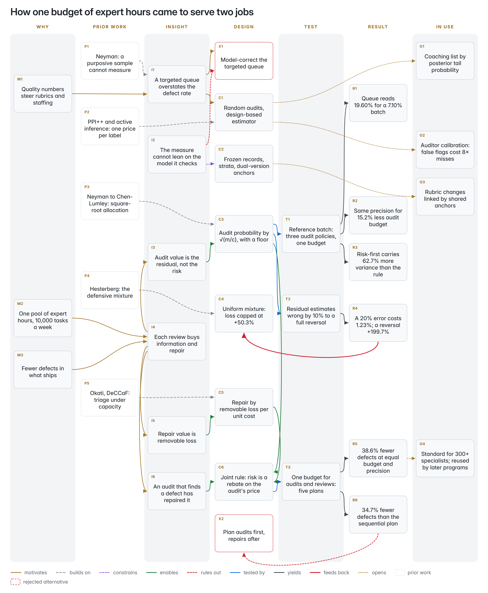

# Research route

How the argument was built: which observation forced which design choice, where a result went back and changed the
design, and what the design became in operation. The work did not run from problem to solution in one line.
Measurement and repair draw on the same hours, so they were worked out against each other, and two results reshaped
the design that produced them.

<picture>
  <source media="(prefers-color-scheme: dark)" srcset="../assets/route-dark.png">
  
</picture>

## Reading the figure

Columns are kinds of step, not stages in time. A link can run between any two columns, and two run backwards, from
a result to the design.

| Link | Meaning |
| --- | --- |
| motivates | A need or an insight that made the next step necessary |
| builds on | A published result the step starts from |
| constrains | Something that limits what a step may do |
| enables | A step that makes another one possible |
| tested by / yields | A design and the test that checks it; a test and what it produced |
| feeds back | A result that changed the design |
| rules out | A finding that excludes an alternative |
| opens | A design or result that became an operating standard |

Solid boxes are my own steps. Dotted boxes are prior work, and red dashed boxes are alternatives I rejected. Design
boxes are numbered C1 to C6 so that they are not confused with the derivations D1 to D15.

## The five threads

### 1. A measurement that does not lean on the risk model

M1 → I1 → C1, with I2 ruling out X1 and constraining C2.

The error rate in a review queue exceeds the batch's by $`\mathrm{Cov}(\pi, q)/E[\pi]`$
([D1](derivations.md#d1-what-a-review-queue-estimates)), so the better review is targeted, the worse the dashboard
reads (I1). This is Neyman's argument against purposive selection, applied to a review queue (P1). There are two
ways out. One corrects the targeted queue with a model of the selection (X1). I rejected it on principle (I2): the
quality estimate exists to check the risk model, so it cannot be valid only when that model is right. The other is
a separate stream of random audits with known probabilities, read through a prediction-assisted estimator that is
unbiased for any predictions (C1, [D4](derivations.md#d4-the-estimator-is-unbiased-for-any-predictions)). The
same principle fixes the operating standards (C2): nothing is chosen after labels are seen, and originals and
revisions are separate records.

### 2. What an audit is worth

M2, M3 → I4 → I3 → C3 → T1 → R1, R2, R3.

One pool of hours serves two jobs, so every review is bought twice (I4). Valued as information, an audit is worth
the second moment of the residual the predictions leave, $`m_i = q_i(1-q_i) + (q_i - f_i)^2`$, per unit of cost
(I3, [D6](derivations.md#d6-what-an-audit-is-worth)). A submission that is certainly wrong and predicted wrong
teaches the estimate nothing. The allocation follows (C3): probabilities proportional to $`\sqrt{m_i/c_i}`$ with a
floor ([D7](derivations.md#d7-the-optimal-audit-allocation)), the square-root optimum of survey sampling (P3)
carried to a separate cost for every item.

On the reference batch (T1) the risk-first queue reads 19.60% where the batch rate is 7.10% (R1), the rule reaches
any precision target with 15.2% less audit budget than uniform sampling (R2,
[D8](derivations.md#d8-the-gain-over-uniform-sampling-and-the-budget-identity)), and risk-first routing carries
62.7% more variance than the rule (R3).

### 3. Surviving wrong inputs

C3 → T2 → R4 → C4.

The rule is computed from residual estimates, so I asked what their errors cost (T2). The answer has two halves
(R4). Ordinary errors are cheap: the first-order terms cancel and the loss is a quarter of the weighted variance of
the relative errors, 1.23% for a 20% error ([D9](derivations.md#d9-the-quarter-variance-law)). A gross error
is expensive: a residual ordering reversed across the strata raises the variance to 199.7% above uniform. That
second half went back into the design (R4 → C4): the computed probabilities are mixed with the uniform design at
the same budget, which caps the loss at +50.3% for any estimates whatever
([D10](derivations.md#d10-the-mixture-bounds-the-loss-for-any-estimates)). The mixture is Hesterberg's defensive
importance sampling (P4), written for a Bernoulli audit design.

### 4. What a repair is worth

I4 → I5 → C5.

Valued as repair, a review is worth the loss it removes, $`\Delta_i = r_{i0} - r_{i1}`$ (I5), and not the item's
initial risk. A high-risk task that is missing external evidence has a small $`\Delta_i`$: another reviewer cannot
supply what it lacks. Ranking by removable loss per unit cost (C5) is optimal by an exchange argument
([D11](derivations.md#d11-repair-follows-removable-loss)), and it has the threshold structure of optimal triage
(P5).

### 5. One rule for both

I4 → I6 → C6 → T3 → R5, R6, with R6 ruling out X2.

The two values meet in one action: a reference audit produces a reference solution, so an audited defect ships
corrected (I6). Putting that into the batch program gives the joint rule (C6,
[D13](derivations.md#d13-the-joint-rule)), in which the item's residual risk is a rebate on the audit's price. The
measurement rule C3 is its corner when audits repair nothing, and risk-first routing is its corner when the
estimate has no value.

With one budget divided between audits and reviews (T3), the joint rule ships 38.6% fewer defects than risk-first
routing at the same budget and the same precision (R5). The same test settled a question of procedure (R6 → X2).
Planning audits for measurement and then spending the remainder on repair gives the best estimate in the table and
ships 336 defects against 321 for the policy it was meant to replace. Held to that plan's own precision, the joint
rule ships 34.7% fewer defects, and 12.4% to 69.3% fewer across the envelope (R6). The two jobs have to be planned
together.

## From design to operation

| Standard | Comes from | What it does |
| --- | --- | --- |
| O1 Coaching list by tail probability | C1 | Reliability is read from the random audit stream, which the routing does not bias, and contributors are selected by the posterior probability of falling below the stratum standard ([D15](derivations.md#d15-selection-by-tail-probability)) |
| O2 Auditor calibration | C1 | The estimator measures audit labels, so an auditor's error has a price in audit hours: +43.8% for a 2% false-flag rate against +5.2% for a 5% miss rate ([D14](derivations.md#d14-the-price-of-an-auditors-error)) |
| O3 Shared anchors | C2 | Each estimate belongs to one frozen criteria version; anchors adjudicated under both versions link them |
| O4 Program standard | R5 | Reliability records, tiered review and random reference audits became the operating standards for more than 300 specialists, and later post-training programs took over the design |

## Every node

| Node | Column | What it is |
| --- | --- | --- |
| **M1** Quality numbers steer rubrics and staffing | Why | Whether a batch is better than last week's, whether a contributor is improving, whether a rubric change moved the defect rate: each is decided from a quality number. |
| **M2** One pool of expert hours, 10,000 tasks a week | Why | More than 300 specialists and vendor queues could review only part of each weekly batch. |
| **M3** Fewer defects in what ships | Why | The same hours have to remove defects from the batch before it is delivered for training. |
| **P1** Neyman: a purposive sample cannot measure | Prior Work | Neyman (1934): a sample chosen for one purpose fails on the quantities it was not chosen for. The GAO Financial Audit Manual applies the same rule to financial audits. |
| **P2** PPI++ and active inference: one price per label | Prior Work | Angelopoulos et al. (2023), Zrnic and Candès (2024): valid inference from a few labels and many predictions. Every label costs the same. |
| **P3** Neyman to Chen-Lumley: square-root allocation | Prior Work | Cochran (1977), Isaki and Fuller (1982), Chen and Lumley (2020): the square-root optimum, by stratum and wave by wave. No cost per item and no repair. |
| **P4** Hesterberg: the defensive mixture | Prior Work | Hesterberg (1995): mixing an importance-sampling design with the nominal one bounds every weight. |
| **P5** Okati, DeCCaF: triage under capacity | Prior Work | Okati et al. (2021), Alves et al. (2024): which cases go to a human under cost and capacity. Batch quality is outside the objective. |
| **I1** A targeted queue overstates the defect rate | Insight | The queue's error rate exceeds the batch's by Cov(π, q)/E[π], and the gap grows as targeting improves (D1). |
| **I2** The measure cannot lean on the model it checks | Insight | A quality estimate exists to check the risk model, so its validity cannot depend on that model being right. |
| **I3** Audit value is the residual, not the risk | Insight | An audit is worth m = q(1 − q) + (q − f)² per unit cost. A submission that is certainly wrong and predicted wrong teaches the estimate nothing (D6). |
| **I4** Each review buys information and repair | Insight | Every expert hour is bought twice: as information about the batch and as repair of an item. The two values rank tasks differently. |
| **I5** Repair value is removable loss | Insight | A review is worth the loss it removes, Δ = r₀ − r₁, not the item's initial risk (D11). |
| **I6** An audit that finds a defect has repaired it | Insight | A reference audit produces a reference solution, so an audited defect ships corrected. This is where the two jobs meet. |
| **X1** Model-correct the targeted queue | Design | Rejected: the corrected number would be only as good as the selection model. |
| **C1** Random audits, design-based estimator | Design | Independent reference audits drawn with known probabilities, read through a prediction-assisted inverse-probability estimator that is unbiased for any predictions (D4). |
| **C2** Frozen records, strata, dual-version anchors | Design | Predictions and probabilities are locked before labels are seen; originals and revisions are separate records; anchor cases are adjudicated under both rubric versions. |
| **C3** Audit probability by √(m/c), with a floor | Design | The clipped square-root rule with a cost for every item minimizes the variance of the estimate at a fixed audit budget (D7). |
| **C4** Uniform mixture: loss capped at +50.3% | Design | Mixing the computed probabilities with the uniform design at the same budget bounds the variance for any residual estimates whatever (D10). |
| **C5** Repair by removable loss per unit cost | Design | Reviews are ranked by Δ per unit cost under specialist capacity; an exchange argument shows the order is optimal (D11). |
| **C6** Joint rule: risk is a rebate on the audit's price | Design | π* = clip √(ν m / (λc − r)₊). The item's residual risk is subtracted from the audit's price, and risk-first routing is the corner ν = 0 (D13). |
| **X2** Plan audits first, repairs after | Design | Rejected: choosing audits for measurement and spending the rest on repair ignores the repair that audits perform. |
| **T1** Reference batch: three audit policies, one budget | Test | A reference batch at the program's scale, 10,000 submissions in three strata, with every entry moved by up to 20% in the envelope. |
| **T2** Residual estimates wrong by 10% to a full reversal | Test | The allocation is recomputed from residual estimates with relative errors of 10% to 50%, and then from an ordering reversed across the strata. |
| **T3** One budget for audits and reviews: five plans | Test | 5,000 cost units divided between audits and reviews under five plans, at matched precision. |
| **R1** Queue reads 19.60% for a 7.10% batch | Result | The risk-first queue overstates the defect rate 2.76 times, and 1.96 to 4.14 times across the envelope. The estimator recovers 7.10% under every policy. |
| **R2** Same precision for 15.2% less audit budget | Result | κ = 0.848: the rule reaches any precision target with 15.2% less audit budget than uniform sampling, 7.5% to 27.3% across the envelope (D8). |
| **R3** Risk-first carries 62.7% more variance than the rule | Result | At the same audit budget, 14% to 137% more across the envelope. |
| **R4** A 20% error costs 1.23%; a reversal +199.7% | Result | Small errors cost a quarter of their weighted variance (D9). A reversed ordering raises the variance to 199.7% above uniform. |
| **R5** 38.6% fewer defects at equal budget and precision | Result | The joint rule ships 197.1 defects where risk-first routing ships 320.9; 19% to 67% fewer across the envelope. |
| **R6** 34.7% fewer defects than the sequential plan | Result | Held to the sequential plan's own precision of 0.515 points, the joint rule ships 34.7% fewer defects, 12.4% to 69.3% fewer across the envelope. On the reference batch the sequential plan also ships more than risk-first routing, 336 against 321. |
| **O1** Coaching list by posterior tail probability | In Use | Contributors are selected by the probability of falling below the stratum standard, at a set false-selection rate (D15). |
| **O2** Auditor calibration: false flags cost 8× misses | In Use | A 2% false-flag rate raises the audit budget by 43.8%; a 5% miss rate raises it by 5.2% (D14). |
| **O3** Rubric changes linked by shared anchors | In Use | Each estimate belongs to one frozen criteria version; the anchor set links versions and detects drift in auditors' standards. |
| **O4** Standard for 300+ specialists; reused by later programs | In Use | Reliability records, tiered review and random reference audits became the program's operating standards, and later post-training programs took over the design. |

## Every link

| # | From | To | Link | Why |
| ---: | --- | --- | --- | --- |
| 1 | M1 | I1 | motivates | Decisions ride on the quality number, so a bias in it is a bias in the decisions |
| 2 | P1 | I1 | builds on | Neyman's argument against purposive selection, applied to a review queue |
| 3 | I1 | X1 | motivates | Correcting the queue with a selection model is the obvious repair |
| 4 | I2 | X1 | rules out | The correction would rest on the model the measurement is meant to check |
| 5 | I1 | C1 | motivates | A separate stream of random audits measures the batch whatever the routing does |
| 6 | P2 | C1 | builds on | The prediction-assisted estimator, here under unequal, designed probabilities |
| 7 | I2 | C2 | constrains | Nothing may be chosen after labels are seen |
| 8 | M2 | I4 | motivates | One pool of hours serves both jobs |
| 9 | M3 | I4 | motivates | Repair is the second job |
| 10 | I4 | I3 | motivates | Valuing a review as information |
| 11 | I4 | I5 | motivates | Valuing a review as repair |
| 12 | I4 | I6 | motivates | Asking where the two values meet in a single action |
| 13 | I3 | C3 | enables | The residual second moment per unit cost is the allocation key |
| 14 | P3 | C3 | builds on | The square-root optimum, carried to a separate cost for every item |
| 15 | C3 | T1 | tested by | Three policies at one audit budget and one estimator |
| 16 | T1 | R1 | yields | The uncorrected queue rate against the batch rate |
| 17 | T1 | R2 | yields | The budget ratio κ at every precision target |
| 18 | T1 | R3 | yields | Risk-first routing as a measurement design |
| 19 | C3 | T2 | tested by | The rule is only as good as its residual estimates |
| 20 | T2 | R4 | yields | The quarter-variance law and the reversed-ordering stress case |
| 21 | R4 | C4 | feeds back | The rule has to survive a wrong pilot, so it is mixed with the uniform design |
| 22 | P4 | C4 | builds on | The defensive mixture, written for a Bernoulli audit design |
| 23 | I5 | C5 | enables | Removable loss is the ranking key |
| 24 | P5 | C5 | builds on | The threshold structure of optimal triage, with specialist capacity |
| 25 | I6 | C6 | enables | The audit's repair enters its own price |
| 26 | C3 | C6 | enables | The measurement rule is the joint rule when audits repair nothing |
| 27 | C5 | C6 | enables | The action choice is the joint rule's second formula |
| 28 | C6 | T3 | tested by | One budget divided between audits and reviews |
| 29 | T3 | R5 | yields | Defects shipped at matched budget and matched precision |
| 30 | T3 | R6 | yields | The sequential plan against the joint rule at the sequential plan's precision |
| 31 | R6 | X2 | rules out | Planning the two jobs one after the other ships more defects at equal budget and precision, everywhere in the envelope |
| 32 | C1 | O1 | opens | The random audit stream gives reliability estimates free of the routing effect |
| 33 | C1 | O2 | opens | The estimator measures audit labels, so an auditor's error has a price in audit hours |
| 34 | C2 | O3 | opens | Frozen criteria versions need a link when the criteria change |
| 35 | R5 | O4 | opens | The joint design became the operating standard |
